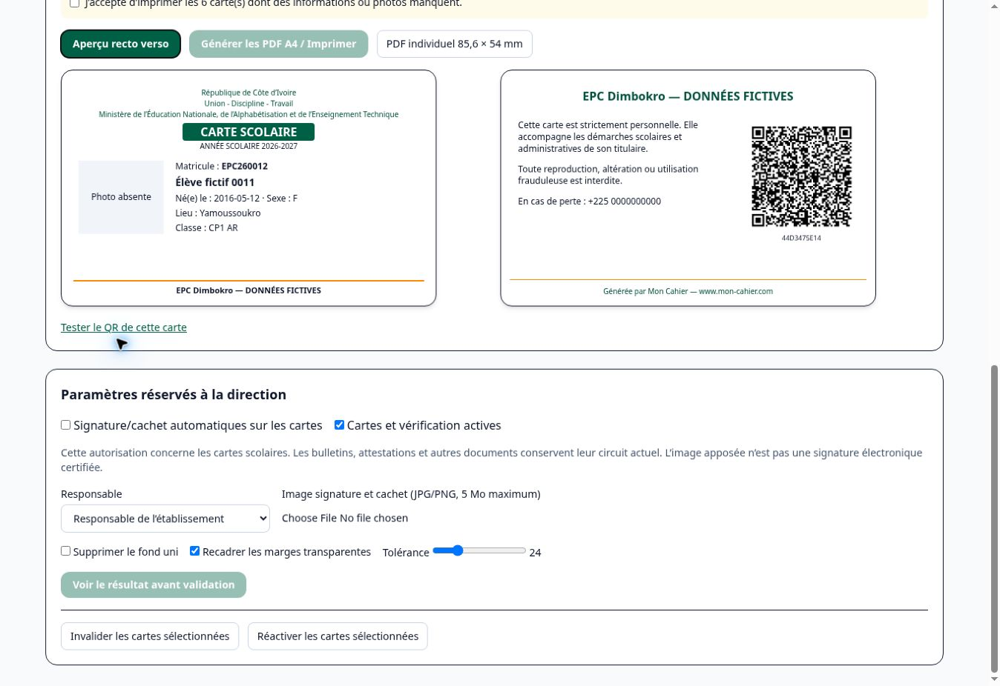

# Module cartes scolaires — recette du 25 octobre 2026

État : développement livré en branche et recette Render isolée. **Non déployé en production. Intégration native Next + Supabase Auth/PostgREST/Storage validée sur une pile locale éphémère en CI. Recette Render publique sur données fictives ; base Supabase cloud de recette non disponible.**

## Sources et base de travail

- Dépôt : `steedo1/CAHIER-D-ABSENCES`.
- Production Render auditée : `mon-cahier-test`, service `srv-dbc291on74is73f4692g`, déploiement `dep-dbefo8rncjis73e42ac0`, commit `28dbd1ae88c4a1c40b3fc419e04055202dff06c3`, branche `migration-render-test-20261021`.
- Le nom « test » de ce service ne signifie pas qu'il est disponible pour la recette : il sert la production officielle.
- Référence `ac615564` : GitHub compare indique la production en avance de 54 commits, aucune régression de base volontaire.
- Branche historique `reprise-propre-5418ce7-20260729` conservée ; aucune réécriture, fusion ou modification.
- Branche dédiée : `feature/cartes-scolaires-20261025`, créée depuis le commit de production.
- Commits initiaux : `4e49da31b7723a5f8c70586dff9960e42a084e52`, `a7c7d6a0e74297c94dda93d9bc4b1012b3d825a5`, `380ef22c5a660bb64d5d2e8571e8f9d6aa421f95`.
- Compte rendu initial : `d326a973696ff00f2bd052103f95df9bc9de6b72`.
- Vérification native Supabase : `c4f85610eab05e6b379cbe50b37df6de7b2b61ae`, `83fdf46d355e26fb2ac2702f2e5a4dad03722e8d`.
- Correction du PDF arabe et du script d'installation local : `ffd398b38a8fff473bf3788e284509a5028c578b`, `6f03f28d2f76df73bb25aae18ea53c54a0b7d24d`.
- Protection du corps des scans publics et compteurs SQL : `4d571599476c02e7a409746a836a9f34f2c9320a`.
- Dernier commit testé et déployé en recette : `28a50137724ae4f20db6db056632b427a98e902c` (mesure du pic RSS Next). Les commits de compte rendu suivants ne changent pas le code exécuté.
- PR en brouillon : https://github.com/steedo1/CAHIER-D-ABSENCES/pull/226 . Ne pas fusionner avant les contrôles manquants et la validation explicite du propriétaire.

Les PR ouvertes ont été examinées : notes mobiles, EPC Cloud, relais, appels serveur, anciens travaux franco-arabes. Aucun de ces travaux n'est intégré ou écrasé par cette branche.

## Fonctionnalités implémentées

- Rubrique « Cartes scolaires » dans Administration & services ; accès du correspondant fichier et de l'éducateur, dans ses classes affectées.
- Établissement dérivé de la session vérifiée, jamais d'un paramètre envoyé par le navigateur. Éducateur sans affectation : aucun élève.
- Choix d'année, classe(s), niveau, section française/arabe, recherche nom/matricule ; sélection individuelle, résultats filtrés ou établissement.
- Identités et inscriptions existantes réutilisées ; aucun INSERT/UPDATE dans les élèves, classes, inscriptions, bulletins ou attestations.
- Aperçu recto/verso, QR obligatoire, alertes sur photos et données manquantes, acceptation explicite avant impression incomplète.
- PDF individuel de 85,6 × 54 mm ; A4 de dix cartes par feuille, versos en miroir pour bord long ou bord court, repères de coupe ; export navigateur par lots de 100.
- Texte et QR vectoriels, photos normalisées dans le navigateur, police DejaVu Sans embarquée avec sa licence (caractères latins et arabes). Les noms arabes et champs bilingues sont composés par runs Unicode puis façonnés en mots connectés par Fontkit ; rendu PDF arabe inspecté visuellement, exemple `sample-arabic.pdf` inclus dans les preuves CI.
- Logo d'établissement, en-tête, photo, matricule, nom, naissance, sexe, classe ; mentions de perte, fraude et « Générée par Mon Cahier — www.mon-cahier.com » au verso.
- Aucun emblème d'État ajouté automatiquement. Dénomination 2026 ivoirienne contrôlée sur la source officielle : https://www.education.gouv.ci/index.php/Flash/details/46 (décret 2026-509 du 5 août 2026). Les autres pays, intitulés personnalisés et documents historiques conservent leur configuration.

## Signature et cachet

Une image composite JPG/JPEG/PNG est traitée par Sharp. Le retrait de fond est facultatif et limité aux pixels de couleur voisine du fond reliés au bord ; les détails blancs enfermés dans un cachet sont préservés. Tolérance réglable, aperçu, recadrage des marges transparentes et conservation exacte de l'original. Sans retrait de fond, le fond est conservé.

Validation de fidélité et autorisation de l'établissement requises dans l'interface avant enregistrement. Original et dérivé sont enregistrés dans le bucket privé existant `signatures`, sous un chemin propre à l'établissement et au responsable. L'API refuse un bucket public. L'original n'est téléchargeable qu'après le garde administrateur ; aucun chemin de stockage brut n'est renvoyé au lecteur. Les utilisateurs habilités à imprimer reçoivent uniquement l'image dérivée nécessaire au document ; comme toute image imprimée, cette représentation reste techniquement extractible par le destinataire autorisé.

Automatisation des cartes désactivée par défaut. Seuls `admin` et `super_admin` peuvent configurer/invalider ou récupérer l'original. Les rôles `file_correspondent` et `educator` peuvent préparer et imprimer dans leur périmètre, sans configurer les signatures. Finance, enseignants, parents et comptes classe n'obtiennent aucun droit supplémentaire.

En franco-arabe : responsables existants de `school_teaching_signatories_v1` et sections de `school_student_programs_v1` réutilisés. Aucune déduction depuis le nom de la classe. Une section ambiguë ou un responsable absent empêche l'application automatique et produit un avertissement ; aucune substitution silencieuse du directeur général.

Les moteurs et paramètres actuels des bulletins/attestations ne sont pas modifiés. L'image apposée n'est pas une signature électronique certifiée.

## QR et consommation

Le serveur prépare en lot des jetons chiffrés et authentifiés AES-256-GCM. Les clés de chiffrement et de dérivation du nonce sont séparées par HMAC ; le nonce est déterministe sur l'identité binaire. Le jeton opaque de 136 caractères contient uniquement institution/élève/inscription/classe/année, sans nom, matricule ou date de naissance en clair. Une même inscription et année reproduit exactement le même jeton. Un changement d'inscription/classe ou d'année en produit un autre ; l'ancien échoue au contrôle des données réelles.

`SCHOOL_CARD_QR_SECRET` est obligatoire, exclusivement côté serveur et indépendant des secrets des bulletins. Il faut une clé aléatoire forte, durable et sauvegardée ; la changer invalide les QR existants. Aucun identifiant QR n'est inséré en base. La génération de l'image QR et du PDF n'utilise pas Supabase. La page publique reçoit le jeton dans le fragment URL, l'efface de la barre d'adresse, puis ne vérifie qu'après action explicite. Aucune vérification publique n'est lancée par un aperçu.

Un vrai contrôle effectue cinq lectures groupées : inscription/élève/classe, année, établissement, configuration, révocation. Il vérifie les dates, année active, inscription ouverte, identité institutionnelle et statut actif de l'élève. Aucun nom, photo, matricule ou naissance n'est divulgué au public. Un jeton falsifié est rejeté avant SQL. Limites : 12 contrôles/IP/minute, 8/jeton/minute, 120 contrôles/processus/minute ; stockage mémoire borné. Ces limites sont adaptées à l'instance unique auditée ; ajouter une limite distribuée/edge **avant** tout passage à plusieurs processus ou instances. Le serveur ne conserve pas les IP brutes.

L'audit historique de `bulletin_qr_codes` a relevé notamment 206 255 appels d'une forme de SELECT et 206 618 appels d'une ancienne forme d'UPDATE. Ces compteurs sont cumulés, leur période n'a pas été déterminée : ce ne sont ni un débit actuel ni une mesure du nouveau module. Le code des cartes ne réutilise pas le store des QR de bulletins.

### Mesure locale instrumentée, données fictives sans photos

Les nombres ci-dessous sont des appels SQL du transport simulé, avec les chargements normaux et les contrôles de permission inclus. Ce ne sont pas des mesures de latence du Supabase de production. Les éventuels téléchargements d'images Storage et la vérification d'authentification sont des catégories séparées.

| Cartes | Chargement SQL | Préparation SQL | Écritures QR | Réimpression SQL en session | PDF local |
|---:|---:|---:|---:|---:|---:|
| 500 | 19 | 40 | 0 | 0 | 1.460 s |
| 1000 | 31 | 80 | 0 | 0 | 2.530 s |

Les images de photos privées sont préparées avec des URLs signées en lot ; leurs téléchargements restent normalement proportionnels au nombre d'images, mais ne déclenchent pas de SELECT élève par image. Les signatures nécessaires sont chargées au niveau du lot, pas par carte.

## Vérifications accomplies et limites

- 16 tests du module : jetons, falsification, stabilité, géométrie, signataires, permissions, isolation, origin Render derrière TLS, aperçu/import privé de signature, concurrence de configuration, révocation, expiration, RLS, audit transactionnel, ordre bilingue arabe et borne du corps des requêtes publiques même sans Content-Length.
- Migration réellement exécutée et éprouvée sur PostgreSQL local PGlite : refus anon/authenticated, garde de révocation entre établissements, historique atomique, révision périmée refusée.
- 353 contrôles scolaires existants validés. Le test comparatif historique avait initialement échoué faute du commit source dans le clone peu profond ; il a été rejoué avec succès après récupération de `6d6799fe7c0e39de011b417b99179f4b00bc1fe4`. Le CI charge désormais tout l'historique et a repassé les 353 tests.
- 46 contrôles ciblés de QR bulletins, signatures franco-arabes et photos d'attestations passent aussi (recouvrement partiel avec la suite scolaire).
- `npm ci` propre depuis le lockfile puis compilation complète Next 15.5.28 réussie localement, avec valeurs de configuration fictives pour le rendu statique ; aucun secret réel utilisé. Les avertissements Edge Supabase préexistants restent visibles.
- PDF individuel : dimensions vérifiées 85,6 × 54,0 mm. Géométrie des deux retournements A4 contrôlée mathématiquement. Dix QR sur dix extraits des versos A4 décodés indépendamment à 300 dpi ; QR individuel décodé identique au lien prévu.
- Navigateur de recette : sélection, aperçu et export de 12 cartes réussis ; 1 000 cartes sans photos produites en dix PDF de 100, sans erreur d'interface. Ce contrôle ne simule pas une imprimante ni un appareil photo de téléphone.
- CI complet réussi sur le commit `28a50137724ae4f20db6db056632b427a98e902c` : https://github.com/steedo1/CAHIER-D-ABSENCES/actions/runs/40190496635 . Tests, compilation et navigateur sont verts. Preuves PDF, captures et mesures : https://github.com/steedo1/CAHIER-D-ABSENCES/actions/runs/40190496635/artifacts/12598520288 .
- Benchmark navigateur Chrome desktop réel avec des textures JPEG synthétiques distinctes de 240 × 320 pixels : 500 cartes en 5,438 s (5 PDF, 31,42 Mo) ; 1 000 cartes en 10,401 s (10 PDF, 62,84 Mo). Aucune erreur JavaScript du produit. Zéro écriture SQL et réimpression dans la même session sans nouvelles lectures, assertion exécutée dans le navigateur.
- Lectures du transport simulé : 59 pour 500 cartes, 111 pour 1 000 cartes, et respectivement 6/12 opérations groupées de signature d'URLs Storage. L'augmentation n'est pas d'une requête QR par carte. Aucune requête vers `bulletin_qr_codes`.
- Heap JavaScript du navigateur avant/après export : 20,6/22,5 Mio (500), 44,7/36,3 Mio (1 000). Ce ne sont **pas** le pic mémoire total du navigateur : les images décodées et buffers natifs ne sont pas inclus dans cette métrique. RSS du serveur de transport local CI : 215,3/205,0 Mio.
- Mémoire observée via l'API Render du serveur de recette séparé : environ 79–131 Mio sur l’ensemble des échantillons ; la dernière série du 25 octobre 11:46–11:54 UTC est de 77,3–99,6 Mio, sous la limite de 512 Mio. Ces échantillons concernent le serveur de recette ; ils ne constituent pas une charge réelle Supabase sur l'application Next de production.
- Navigation publique du lien QR sur Render : après clic explicite, « Carte valide », établissement, année et référence affichés, sans identité personnelle. La même carte a ensuite été invalidée via l'interface administrateur : le nouveau contrôle public a renvoyé « Carte non valide ». Contrôle physique avec caméra de téléphone non réalisé.
- Aucun essai matériel d'impression recto verso ou de scan avec l'appareil photo d'un téléphone n'a été effectué. Les paramètres d'imprimante (100 %, retournement, entraînement et tolérance de découpe) exigent un essai d'une feuille avant tout grand tirage.

### Contrôle réel des établissements, lecture seule

| Établissement | Élèves distincts avec inscription ouverte 2026–2027 | Références de photos présentes |
|---|---:|---:|
| CSCA | 527 | 446 |
| Collège Privé Dieudonné | 117 | 34 |
| EPC Dimbokro | 231 | 0 |

Les chemins des 446 photos CSCA et 34 photos Dieudonné ont aussi été vérifiés en lecture seule : tous respectent le préfixe établissement/élève accepté par le module. Aucun fichier élève n’a été téléchargé pour ce contrôle.

Ces données n'ont pas été copiées dans la recette publique. Toutes les inscriptions et noms employés par les essais sont fictifs. Les homonymes sont distingués par UUID et inscription ; aucune déduction d'identité depuis le nom. Les signataires EPC français/arabe existants ont été identifiés, sans changement des comptes ou nominations.

## État de déploiement

- Production officielle : inchangée ; aucun SQL de migration, aucune écriture élève, signature, inscription ou QR effectuée par cette mission.
- Recette séparée : https://mon-cahier-cartes-qa.onrender.com/ ; service `srv-dbeto3om7kps73f2ect0`, déploiement `dep-dbeuruoae00c73e6th50` au commit `28a5013…`, plan Free, auto-déploiement désactivé. Commande de build `npm ci --include=dev && node scripts/build-school-cards-qa.mjs`, démarrage `node --max-old-space-size=288 scripts/school-cards-qa-server.mjs`.
- Le serveur de recette refuse les variables de connexion Supabase ; il exécute les handlers du module sur un transport fictif en mémoire, avec bandeau explicite. Un redémarrage efface ses données et change sa clé QR de test. Ce serveur ne doit jamais remplacer le démarrage Next de production.
- La création d'une branche Supabase isolée a échoué deux fois avec `McpServerError: Invalid or expired requestState`. La liste des branches est restée vide. Aucune branche payante n'a été créée, aucune approbation de coût n'a été présumée.
- Ce blocage a été contourné sans coût cloud : une vraie pile Supabase éphémère est démarrée dans GitHub Actions. La migration exacte est exécutée via `psql` ; trois écoles, comptes Auth et inscriptions fictifs sont créés uniquement sur cette base locale. Les handlers Next compilés utilisent réellement Auth, PostgREST et Storage privé. Les autorisations, URL de photo signée, original privé refusé, aperçu/import de signature, application automatique, QR stable et scans valides/falsifiés/révoqués/changement de classe/année expirée passent. La pile est ensuite arrêtée et supprimée, sans connexion à la production.
- CI natif réussi sur `6f03f28d2f76df73bb25aae18ea53c54a0b7d24d` : https://github.com/steedo1/CAHIER-D-ABSENCES/actions/runs/40190079072 . Première mesure réelle locale : préparation de 500 + repréparation de 100 en 229 ms ; 1 000 + repréparation de 100 en 361 ms, hors PDF et latence réseau cloud. Les nombres de lignes configuration/audit/révocation sont restés 0 avant/après ces exports. Les écritures ultérieures de configuration et révocation appartiennent aux tests explicites correspondants.
- Dernière recette native réussie au commit `28a5013…` : même workflow final, preuve https://github.com/steedo1/CAHIER-D-ABSENCES/actions/runs/40190496635/artifacts/12598295947 . Les résultats SQL bruts, normalisés sans jeton ni donnée élève réelle, sont conservés dans `native-results.json`.

| Cartes préparées | Chargement mesuré | Préparation native | Appels SQL PostgREST observés : chargement / préparation | Écritures SQL pendant ces phases |
|---:|---:|---:|---:|---:|
| 500 | 74 ms | 218 ms | 12 / 37 | 0 |
| 1000 | 140 ms | 406 ms | 24 / 71 | 0 |

Ces mesures sont celles de `pg_stat_statements` de la pile locale réelle, séparées des appels du transport simulé. Le test natif connaît le nombre demandé et arrête sa pagination après 500/1000 lignes ; l'interface normale peut faire une dernière lecture de page vide. Elles incluent les requêtes HTTP PostgREST d'autorisation et de données, mais pas les requêtes internes de GoTrue/Storage, ni la latence du cloud. La repréparation serveur de 100 cartes constate 7 appels SQL et reproduit les jetons ; la réimpression navigateur dans la même session reste à zéro lecture. Les nombres de lignes des trois tables du module restent inchangés pendant les exports. Pic RSS du **vrai processus Next de test** (`/proc/VmHWM`) : **365,6 Mio**, avec le plafond V8 288 Mio utilisé sur Render. Ce pic CI n'est pas une mesure de charge de l'instance Render de production.

- Une recette native déployée sur Render contre un Supabase **cloud** de test reste à réaliser avant la fusion. Les mesures locales ne représentent ni la latence ni les coûts du Supabase de production.

## Préparation de production — ordre obligatoire

1. Rétablir le flux de création/confirmation d'une branche Supabase de test, ou fournir une base de test dédiée. Accepter son éventuel coût avant création. Ne pas utiliser la production comme substitut.
2. Les tests CI natifs existent déjà ; pour compléter la recette hébergée, appliquer uniquement la migration additive `20261025101927_school_cards_private_configuration.sql` sur cette base de test ; peupler des écoles/inscriptions et comptes fictifs ; créer un bucket `signatures` privé et un bucket de photos privé. Réaliser la recette réelle Native Next → Auth → PostgREST → Storage → PDF → scan public et mesurer les requêtes.
3. Vérifier l'impression d'une feuille et le scan physique. Le rendu logiciel arabe a été corrigé et contrôlé sur PDF ; faire confirmer les noms exacts et les noms très longs par le responsable EPC avec des données autorisées, puis le rendu matériel.
4. Faire relire la migration et obtenir l'approbation explicite de son application en production. Trois nouvelles tables privées uniquement : configuration, révocations et audit ; fonction trigger invoker, pas de SECURITY DEFINER, pas de transformation de données existantes.
5. Configurer une clé `SCHOOL_CARD_QR_SECRET` aléatoire forte et durable, `SCHOOL_CARD_PUBLIC_ORIGIN=https://www.mon-cahier.com`, et `SCHOOL_CARDS_ENABLED=true` **seulement au moment de l'activation approuvée**. Le module est fermé par défaut si le drapeau manque ; aucun QR dégradé sans clé.
6. Recontrôler le commit et les travaux concurrents du service officiel ; intégrer la branche à la base active, sans faire régresser les appels Cloud/PWA. Obtenir la validation explicite de fusion et de déploiement.
7. Déployer le commit validé et attendre son état Render `live`. Tester un compte administrateur, un Service habilité, une carte, un lot de classe, les signatures optionnelles et un vrai scan ; contrôler logs et mémoire puis les appels scolaires, bulletins, listes et attestations.

## Retour arrière

- Avant activation : fermer/laisser la PR en brouillon et conserver la production `28dbd1a…`. La recette est indépendante, ses scénarios ne modifient aucune donnée réelle.
- Après activation approuvée : désactiver `SCHOOL_CARDS_ENABLED`, appliquer le déploiement de configuration et vérifier la fermeture des routes du module ; les autres circuits restent inchangés.
- Si nécessaire, redéployer l'artefact de production sauvegardé `dep-dbefo8rncjis73e42ac0` / `28dbd1a…` si encore disponible, ou reconstruire ce commit compatible. Ne pas restaurer en aveugle une ancienne base de données.
- Garder les trois tables et fichiers privés : aucune suppression n'est nécessaire au retour de code et l'historique doit rester conservé. Ne pas perdre ou remplacer la clé QR ; une rotation invaliderait les cartes déjà imprimées.
- Inspecter les paramètres d'auto-déploiement après retour arrière et vérifier l'état réellement `live`, les appels, les bulletins, les attestations et les logs. La procédure matérielle n'a pas été exécutée sur la production par cette mission.

## Preuve visuelle de recette

## Fichiers modifiés ou ajoutés

Liste exacte relative au dépôt, incluant le code, les contrôles et les preuves.

- `.github/workflows/school-cards.yml`
- `.gitignore`
- `docs/audits/school-cards-20261025/REPORT.md`
- `docs/audits/school-cards-20261025/browser-metrics.json`
- `docs/audits/school-cards-20261025/local-metrics.json`
- `package-lock.json`
- `package.json`
- `public/card-fonts/DejaVuSans.ttf`
- `public/card-fonts/LICENSE.txt`
- `scripts/build-school-cards-qa.mjs`
- `scripts/school-cards-qa-server.mjs`
- `scripts/test-school-cards-browser.mjs`
- `scripts/verify-school-cards-native.mjs`
- `scripts/verify-school-cards.mjs`
- `src/app/admin/cartes-scolaires/page.tsx`
- `src/app/admin/cartes-scolaires/workspace.tsx`
- `src/app/admin/ui/sidebar-nav.tsx`
- `src/app/api/admin/school-cards/revoke/route.ts`
- `src/app/api/admin/school-cards/route.ts`
- `src/app/api/admin/school-cards/settings/route.ts`
- `src/app/api/admin/school-cards/signature/route.ts`
- `src/app/api/public/school-cards/verify/route.ts`
- `src/app/verifier-carte/page.tsx`
- `src/app/verifier-carte/verify-card.tsx`
- `src/lib/auth/file-correspondent.ts`
- `src/lib/school-card-bidi.ts`
- `src/lib/school-card-export.ts`
- `src/lib/school-card-image.ts`
- `src/lib/school-card-pdf.ts`
- `src/lib/school-card-token.ts`
- `src/lib/school-cards.ts`
- `src/lib/server/school-cards.ts`
- `src/types/pdfkit-browser.d.ts`
- `supabase/migrations/20261025101927_school_cards_private_configuration.sql`
- `test/fixtures/school-cards-native-base.sql`
- `test/helpers/school-card-fixture.mjs`
- `test/school-cards-api.test.mjs`
- `test/school-cards-db.test.mjs`
- `test/school-cards.test.ts`
- `docs/audits/school-cards-20261025/recette-epc.jpg`
- `docs/audits/school-cards-20261025/native-results.json`
